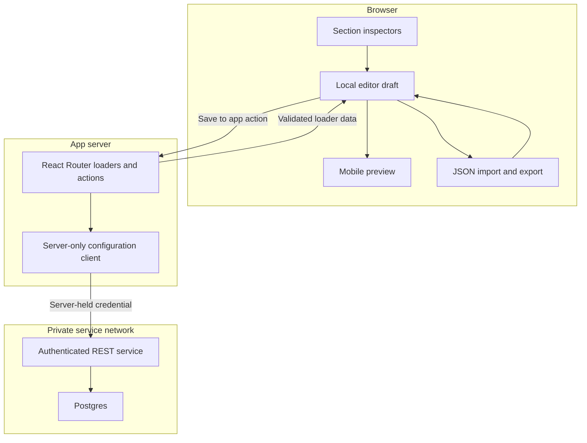
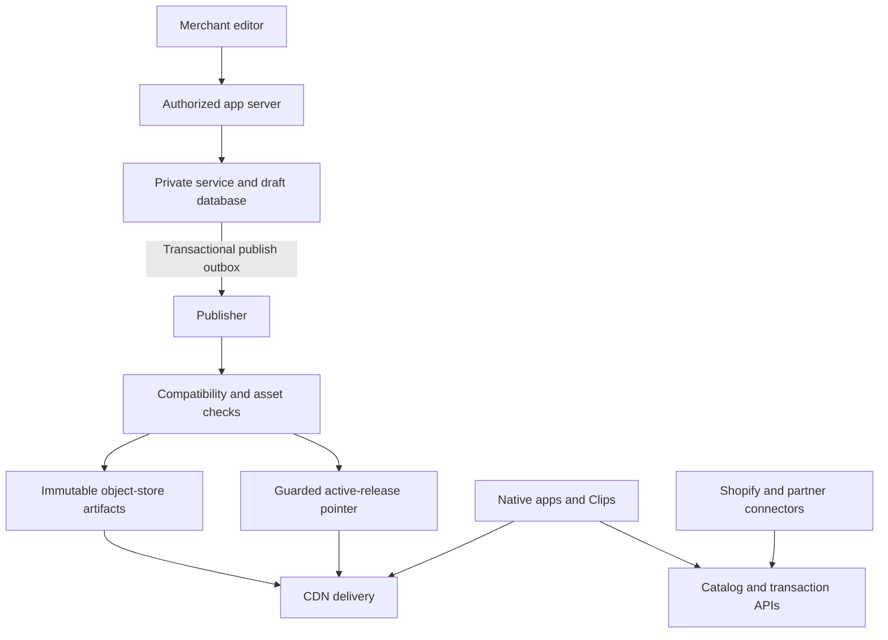

# Reactiv Home Screen Editor: Client-Inspired Architecture

Prepared for Anthony Teixeira · 10 October 2026

## 1. Recommended design

Build the assessment with **React Router v7 in framework mode, TypeScript, a separate private REST configuration service, shared runtime validation, and Postgres**. Keep preview updates entirely local. Use server loaders for reads and server actions for writes. Make the private service boundary visible in the code and tests.

For enterprise deployment, extend this foundation with **immutable published configurations delivered through a CDN**, a reliable publishing worker, tenant isolation, compatibility gates for mobile clients, and tested recovery procedures. Merchant editing and shopper delivery must have separate capacity and failure domains.

This is an architecture proposal, not an implemented system or a load-test report. The assessment implementation is deliberately bounded; the enterprise design describes additional work.

**What “beyond the most demanding client” can honestly mean:** design for the largest catalog and integration complexity disclosed publicly, then define a demanding, measurable workload envelope and prove it. Reactiv does not publish enough per-client concurrency, latency, availability, or recovery data to establish which client is most demanding or guarantee that a proposed system exceeds all of them. Catalog size, revenue, daily users, and requests per second are different measurements.

## 2. Evidence from real Reactiv projects

The evidence below comes from first-party Reactiv project walkthroughs and customer stories. These describe actual product behavior and some implementation choices, but do not disclose complete backend architectures. The architectural conclusions are explicitly my inferences.

| Published project or platform evidence | Architectural inference | Application to this editor |
| --- | --- | --- |
| **Indigo:** Reactiv describes millions of SKUs, a homepage synchronized with web merchandising, and handoffs into native product and collection screens. The walkthrough identifies Constructor, Yotpo, Swym, Talon.One, and Shopify integrations. [R1] | Separate presentation configuration from catalog, inventory, loyalty, and checkout. Use typed navigation targets and integration adapters. | Store ordered presentation blocks, not a catalog dump. Leave a seam for product/collection references and a navigation resolver. |
| **Missouri Star Quilt Co.:** the story describes the collapse of a previous app serving up to 200,000 daily users, an emergency bridge, and replacement features including Daily Deals, shoppable tutorials, and cloud sync. [R2] | Preserve a working experience during migrations. Support backward-compatible content, reversible releases, and isolated feature additions. | Version the schema; preserve configuration order and stable identities; design publication and rollback independently of editing. |
| **Hobbiesville:** the published build has a 130,000-SKU synchronized catalog, React Native rendering, app-exclusive drops, pre-orders, and bot protection. Migration retained the old app as a fallback. [R3] | Expect bursty demand and partner failures. Keep content reads independent of editing and inventory decisions; stage cutovers. | Prepare a cacheable read model, isolated connectors, and a migration strategy. Bot protection belongs on applicable shopper transaction paths. |
| **Top of the Mornin’:** the story describes branded browsing, app-only offers, Klaviyo flows, and Reactiv Clips. [R4] | Campaign changes need fast, safe publishing; different entry points should reuse compatible content and navigation. | The same validated block model can feed full-app and Clip-specific publication variants later. |
| **Reactiv platform:** public materials describe modular developer tooling, reviewed custom-code changes, localization, AWS infrastructure, role-based access, and a 99.9% enterprise uptime SLA. [R5, R6] | Extensibility needs controlled contracts, compatibility review, identity-based authorization, and operational evidence. | Use a small block registry and server boundary now; add publication gates and production controls before making availability claims. |

An important nuance: Indigo's walkthrough describes a web-synchronized homepage with native handoffs, while Hobbiesville's describes React Native rendering. These are different solutions. This assessment builds a **web editor with a mobile-shaped preview**, not either customer's native app. Sharing a configuration contract later does not make DOM components usable in React Native.

## 3. Exact assessment coverage

Source: the supplied four-page “Full-Stack Take-Home Exercise — Mobile App Home Screen Editor.” The brief favors a functional, clean, extensible foundation. [A1]

| Assessment requirement | Design decision | Evidence to show in the submission |
| --- | --- | --- |
| React Router v7 framework mode or server-backed Next.js | React Router **v7**, server runtime enabled; pin a supported patched v7 release in the lockfile | Framework configuration and runnable server build |
| Multiple carousel, text, and CTA sections | Discriminated section union in an ordered array; stable section IDs | Add two of each type and modify them independently |
| Horizontal carousel; editable image URLs; three orientations | CSS overflow and scroll snap; image list editor; explicit aspect-ratio enum | Scroll, add, edit, remove; test portrait, landscape, square |
| Title, description, and separate colors | Text renderer and typed text inspector | Live title/description changes and independent colors |
| CTA label, URL, button color, label color | CTA renderer and typed CTA inspector | Valid destination and independent colors |
| Reorder sections | Accessible move-up/move-down controls as the baseline | Order changes immediately and survives Save/reload |
| Immediate preview | Local React reducer state; no network dependency while typing | Preview works while service latency is injected |
| Responsive, friendly editor | Inspector and preview side by side on desktop; stacked or tabbed on narrow screens | Keyboard workflow and representative phone viewport checks |
| JSON import/export; graceful invalid input | Portable versioned document, strict parsing, atomic replacement of the draft | Export/import round trip; malformed import leaves draft intact |
| Configuration ID, schema version, timestamp, payload | Service-generated metadata plus validated payload | Typed create/get/update responses |
| Create, load by ID, update | Private `/v1/configurations` REST routes | Contract/integration tests for all three operations |
| Credentials only on server; loader/action mediation | `.server.ts` client wrapper; browser talks to the app server | Build inspection and a browser-network assertion |
| Save then reload restores data | Durable Postgres storage and persistent local volume | End-to-end Save/reload and service-restart checks |
| Meaningful tests, environment variables, README, Decision Log | Test matrix and delivery checklist below | Public repository with reproducible setup and a 1–2 page actual AI Decision Log |

Autosave and managing multiple configurations are optional in the brief. The create API is required even if the demo UI initially opens one seeded configuration. Publishing, native SDKs, commerce integrations, and enterprise deployment are extensions rather than assessment requirements.

## 4. Assessment topology and trust boundary



Use two application processes in one repository: the React Router app and a small TypeScript configuration service, for example Fastify. Separate processes make the private HTTP contract and its credential boundary demonstrable. A single database is sufficient. Internal service modules remain ordinary functions; do not turn each block or domain into another service.

React Router v7 documents server loaders, server actions, and `.server` modules. Loaders/actions are removed from client bundles; accidental imports of a `.server` module into the client graph fail the build. Route modules themselves should remain normal route files because the framework handles their server/client exports specially. [T1–T3]

### Responsibility boundaries

| Layer | Owns | Must not own |
| --- | --- | --- |
| Preview components | Rendering a supplied block, accessibility, image fallback | Fetching or saving configuration, credentials, database calls |
| Inspector components | Field inputs, inline feedback, reducer commands | Persistence or service authentication |
| Editor reducer and hooks | Ordered draft, selection, dirty state, save reconciliation | HTTP secrets or independent copies of the same persisted document |
| Shared contracts | Type definitions, runtime validation, version adapters, error shapes | Framework imports, environment variables, server-only clients |
| App loaders/actions | User/demo scope, request parsing, server-side validation, mediation | Trusting tenant or actor IDs supplied by the browser |
| Configuration service | Private authentication, validation, conditional writes, durable metadata | UI presentation, shopper checkout, accepting arbitrary external fetch targets |
| Repository module | Tenant-scoped SQL and atomic persistence | UI or authentication policy |

## 5. Data contract: extensible without being a general CMS

Use a plain JSON document. Array order is the screen order; do not maintain a second `position` field that can disagree with it.

```ts
type Image = { id: string; url: string; alt: string };

type Section =
  | {
      id: string;
      type: "carousel";
      images: Image[];
      aspectRatio: "portrait" | "landscape" | "square";
    }
  | {
      id: string;
      type: "text";
      title: string;
      description: string;
      titleColor: string;
      descriptionColor: string;
    }
  | {
      id: string;
      type: "cta";
      label: string;
      url: string;
      backgroundColor: string;
      labelColor: string;
    };

type ScreenData = { sections: Section[] };
type EditableDocument = { schemaVersion: 1; data: ScreenData };

type Configuration = EditableDocument & {
  id: string;
  revision: number;
  updatedAt: string;
};
```

Keep these version concepts separate:

| Concept | Meaning |
| --- | --- |
| `/v1` API version | HTTP contract shape and operation semantics |
| `schemaVersion` | Persisted/imported document format |
| `revision` | Changes to one configuration; used for concurrency control |

The service generates configuration IDs, revision numbers, and UTC timestamps. The browser never controls `updatedAt` or tenant ownership. Section/image IDs are non-secret stable identifiers validated for shape and uniqueness. They are not authorization.

A typed registry maps each of the three block types to its default factory, inspector, renderer, and shared schema. Use exhaustive TypeScript handling. Adding a fourth type should involve its contract, renderer, inspector, and focused tests, without editing the persistence implementation. A static registry is enough; dynamically downloading executable renderers from configuration is outside scope.

### Proposed validation policy

Use Zod or another single runtime validator in both the browser and servers. TypeScript alone cannot validate JSON received over a network or uploaded from disk. Maintain one canonical schema rather than hand-writing inconsistent validators at each boundary.

| Input | Policy |
| --- | --- |
| Colors | Accept `#RGB` and `#RRGGBB`; normalize to six-digit hex on successful validation. Document that alpha colors are unsupported in schema v1. |
| Image/CTA URLs | Parse as absolute HTTP(S) URLs; reject executable schemes, embedded credentials, and unsupported protocols. Prefer HTTPS; production published assets require it. |
| Text | Plain text, escaped by React; title ≤200 characters, description ≤5,000, CTA label 1–120 after checking for blank content |
| Images | ≤20 per carousel, ≤100 across the document; URL ≤2,048 characters; alt text ≤300 |
| Sections | ≤100; unique section IDs; image IDs unique within a carousel |
| Payload/import file | ≤256 KiB in UTF-8; enforce request and file limits before expensive parsing |
| Object shape | Strict known keys, valid discriminators, supported schema version, bounded nesting |
| Empty document/carousel | Valid; show an explicit empty state with an add control |

These limits are chosen guardrails, not requirements from Reactiv or measured client thresholds. They prevent an editor document from becoming an unbounded content database. Larger catalogs do not require larger home-screen JSON.

Allow incomplete values while typing. Preserve the input string, show validation feedback, and use the last valid style or a safe default in the preview. Block Save/export until the draft is valid. Do not transform `#` into a destructive field reset on each keystroke. URL syntax validation cannot prove an image exists; loading errors need a separate fallback.

## 6. Editor behavior and state ownership

Use `useReducer` and Context around the editor. Keep the draft as the source for both inspectors and preview. Keep UI-only fields outside the saved payload: selected section, panel visibility, validation errors, save status, and in-flight request metadata.

Suggested reducer commands: `addSection`, `removeSection`, `moveSection`, `updateSection`, `addImage`, `updateImage`, `removeImage`, `importDocument`, and `saveAcknowledged`. Generate stable IDs once when adding, not while rendering. Preserve selection across reorder; when removing the selected block, select a neighboring block or show the empty inspector.

Use separate state/dispatch contexts if helpful and memoize individual section renderers with stable references. Avoid a global store framework until profiling justifies it. Start with a simple immutable array and focused updates; 100 blocks do not justify distributed state or a CRDT.

### Preview and usability

Define portrait as `3 / 4`, landscape as `16 / 9`, and square as `1 / 1`. These exact ratios are documented assumptions because the brief supplies names rather than numeric ratios. Use `object-fit: cover`, horizontal scroll snap, reserved image dimensions, keyboard-operable previous/next controls, and visible empty/broken-image states. No automatic carousel motion is needed.

Render text as text, not HTML. Preserve description line breaks and wrap long content. Make CTA preview clicks reveal the configured destination without navigating away from the editor; opening a destination should be an explicit secondary action. Add labeled inputs, visible focus, and live save/error announcements. Move buttons remain available if drag-and-drop is added later.

Reserve media space to avoid layout jumps; load below-the-fold images lazily and prioritize the first visible media. A future custom renderer should have a section-level error boundary so one faulty block does not remove the whole screen. These measures support the declared document limit; profiling still determines whether more optimization is needed.

Use a flexible desktop split layout and a narrow-screen inspector/preview switch or stack. The phone preview must fit the viewport and remain scrollable. Warn about poor color contrast rather than rejecting otherwise valid colors: users can configure colors the brief permits, while seeing the consequence. Author meaningful image alt text; a generic slide number is only a preview fallback.

### Save correctness, including edits made during a request

Track the last saved document, server revision, and a local edit sequence. Save captures an immutable draft snapshot and that sequence. Only one Save runs at a time; typing can continue.

If the user edits again before Save returns, update the known server revision and saved baseline, but retain the newer local draft and its dirty status. Only replace the draft with a normalized response if no newer local edits occurred. Apply the same rule to React Router's automatic loader revalidation: fresh loader data must not blindly overwrite a dirty editor.

Example: title **A** is submitted, the user types **B**, and the server acknowledges **A**. The editor displays **B**, marks it unsaved, and the next Save uses the acknowledged revision. A “saved” toast must not imply that **B** was persisted.

On validation errors, retain the draft and show field paths. On network/service errors, retain the draft and offer retry. On a revision conflict, retain the draft and offer to compare with the latest server document, reload it explicitly, or export local work. Never resolve conflicts by silently overwriting the remote document.

Do not automatically create or reseed a configuration when a load fails: that would hide an outage or missing ID behind a plausible default. Seed the demo configuration explicitly, and use a server action for genuine creation.

## 7. Private REST API and server mediation

### Contract

| Method and path | Request | Success | Failure examples |
| --- | --- | --- | --- |
| `GET /v1/configurations/:id` | ID and private authentication | `200`, configuration, strong `ETag` | `401` invalid service credential; tenant-scoped `404` |
| `POST /v1/configurations` | Valid editable document | `201`, configuration, `Location`, `ETag` | `400` malformed JSON; `422` invalid document |
| `PUT /v1/configurations/:id` | Valid editable document; `If-Match` from the loaded revision | `200`, updated configuration and `ETag` | `404`; `412` revision mismatch; `428` missing required precondition |

Use `413` for excessive body size, `415` for unsupported media type, `429` for enforced quotas, and `503` for temporary service/database unavailability. The required-precondition and rate-limit status codes are specified separately in RFC 6585. [T7] Represent errors consistently:

```json
{
  "error": {
    "code": "VALIDATION_FAILED",
    "message": "Some fields need attention.",
    "requestId": "generated-request-id",
    "issues": [
      { "path": "data.sections[2].url", "message": "Use an absolute HTTP(S) URL." }
    ]
  }
}
```

Return safe, field-addressable errors, not stack traces, tokens, SQL, or raw upstream bodies. Validate service responses at the app-server boundary too. The app server should map an unexpected private-service `401` to a safe server/configuration error; it is not necessarily a reason to tell the user to sign in.

Conditional requests are designed to prevent lost updates. Require a strong `If-Match` validator and return `412` when the submitted revision is stale. Define one JSON representation for the private service so its strong revision ETag is not incorrectly reused for different representation encodings. [T5]

### Initial load

1. The app loader derives the demo/user scope on the server and authorizes access to the requested ID.
2. A `.server.ts` configuration client calls the private service with the server-held credential and a bounded timeout.
3. The service validates authentication and scope, reads durable data, and returns validated metadata and payload.
4. The loader returns only the configuration and safe UI metadata. Hydration initializes the editor once.

### Save

1. The browser posts a document snapshot and its base revision to the app route action, for example through `useFetcher`.
2. The action checks scope and request origin/CSRF policy, validates the document, and derives the service context itself.
3. The server-only client sends authenticated `PUT` with `If-Match` to the private service.
4. The service revalidates and atomically commits the conditional update.
5. The action returns the accepted document/revision or structured issues; the editor reconciles the response as described above.

The browser may request image resources from image hosts and app assets from their host. It must never make configuration-service calls or carry that service's credential. No `clientLoader` or `clientAction` bypass should be introduced for configuration operations.

### Authentication and authorization

The take-home uses a private bearer token stored in uncommitted server environment variables. The service rejects requests with missing or invalid credentials even on the private network. Keep its port unexposed to the public internet; for local testing, use loopback or the Compose network.

Private API authentication and editor-user authorization are separate concerns. For the local demo, a server-selected principal can be limited to a seeded demo workspace, with that limitation documented. This does not provide production identity security. A hosted production editor needs authenticated sessions, tenant membership, and roles checked in each loader/action. An HttpOnly user-session cookie is distinct from the private service credential.

Production roles can be viewer, editor, publisher, and administrator. Derive tenant and actor from the verified session. The private service receives a trusted context from the authenticated app server; scoped short-lived service tokens can strengthen this boundary later. A browser-supplied `tenantId` or `actorId` must not grant access.

Secrets belong in `.server` modules and server environment variables, never in client-prefixed environment variables, loader results, JSON exports, logs, or committed examples. Use an explicit allowed service base URL rather than forwarding arbitrary browser-supplied destinations. Redact authentication and cookies from logs.

## 8. Persistence and concurrency

Use Postgres for the proposed implementation, with a small SQL repository and migrations. It costs one local dependency, but avoids a later database-model change when testing multiple server instances, transactional publication, and tenant isolation.

SQLite is a legitimate simpler assessment choice if setup time is the constraint; it is less suitable for the proposed multi-instance deployment. In-memory storage cannot demonstrate persistence through a service restart. File storage requires explicit locking and crash-safe writes. Whichever storage is implemented must be described honestly in the README.

Core table:

| Column | Purpose |
| --- | --- |
| `tenant_id` | Internal server-derived ownership scope |
| `id` | Configuration identifier |
| `schema_version` | Document version |
| `revision` | Monotonically increasing concurrency version |
| `data` (`jsonb`) | Validated ordered sections and settings |
| `updated_at` (`timestamptz`) | Server/database-assigned timestamp |

Use a composite key/index on `(tenant_id, id)`. Every repository operation requires tenant scope, even when the first demo has one workspace. Require a supported positive schema version, positive revision, and a JSON object. Application validation is still responsible for the full block schema. Do not add JSONB indexes without actual queries that need them.

Implement the update as one conditional statement inside the repository transaction:

```sql
UPDATE configurations
SET data = $1,
    schema_version = $2,
    revision = revision + 1,
    updated_at = now()
WHERE tenant_id = $3
  AND id = $4
  AND revision = $5
RETURNING id, schema_version, revision, updated_at, data;
```

This is illustrative SQL, not a migration already applied. All parameters are bound. If no row is updated, perform only a tenant-scoped existence check to distinguish a missing configuration from a stale revision. Never check a globally visible row to disclose another tenant's ID.

The service returns success only after commit. On an ambiguous timeout, a write might already have succeeded: re-read and reconcile before retrying. Do not automatically retry creation. Durable idempotency records for create/publish and, if needed, save are a production addition: scope each key by tenant, actor/operation and target, store the request hash and result, reject key reuse with a different payload, and write the record in the same transaction as the mutation.

For production, add Postgres row-level security as a second layer. Set tenant context transaction-locally on the same connection used for the query, so pooled connections cannot carry a previous tenant forward. Test policies with the actual application role: superusers and `BYPASSRLS` roles bypass RLS, and owners normally do too unless forced. RLS does not replace session authorization. [T4]

## 9. JSON import/export and schema evolution

Export the current **valid draft**, including unsaved valid changes, as UTF-8 JSON:

```json
{
  "schemaVersion": 1,
  "data": {
    "sections": [
      {
        "id": "section-cta-1",
        "type": "cta",
        "label": "Browse new arrivals",
        "url": "https://example.com/collections/new",
        "backgroundColor": "#102030",
        "labelColor": "#FFFFFF"
      }
    ]
  }
}
```

This portable format deliberately omits service-owned ID, tenant, revision, and timestamp. Import restores content into the selected document rather than redirecting Save to an ID supplied by a file. Keep the selected configuration's current base revision.

Check file size before reading. Parse JSON in an error boundary, validate the entire document, and replace the draft in one reducer command only after every check passes. A malformed file, unsupported version, duplicate section ID, invalid URL/color, or oversized input leaves the existing draft and saved data untouched. Show the reason and field path. Import does not silently persist; the user reviews the preview and selects Save.

Version 1 should reject unknown schema versions and unsupported section types. Add pure migration adapters only when an actual older format exists, with fixtures demonstrating preservation of order, content, colors, and identity. Do not invent a legacy schema merely to show a migration framework.

In production, publish artifacts according to mobile-client capabilities. New JSON is not automatically compatible with installed apps. Maintain required capabilities/minimum renderer support, publish compatible variants where feasible, and block activation if a required journey cannot render. An optional unknown decoration may be skipped with telemetry; a required CTA or purchase flow needs a compatible fallback or the last known compatible artifact. Web and native renderers share contracts and design tokens, with separate UI implementations and compatibility tests.

## 10. Enterprise extension: separate editing from shopper delivery

The assessment stops at Save/reload. A high-traffic merchant platform adds a separate **publish operation**; Save updates a draft, and Publish makes a reviewed revision eligible for shoppers. Never expose the private configuration CRUD API as a shopper API or embed its token in a native app.



The read-only delivery path serves sanitized, intentionally public presentation data. Drafts, customer data, editor permissions, private targeting rules, and service credentials stay off it. Restricted previews or personalized data use an authorized path with appropriate caching rules.

### Reliable publication

1. Validate the selected draft revision, authorization, schema/renderer compatibility, campaign rules, and asset policy.
2. In one database transaction, capture an immutable release snapshot and write a publish job/outbox event. Do not let a later draft edit change the worker's input.
3. A worker consumes jobs with at-least-once delivery and idempotent processing. Upload each artifact under a tenant/configuration/release/variant path, record its digest, and verify its availability before activation.
4. Advance the active-release record using an expected publication generation. An older delayed job must not replace a newer release; rollback creates a new publication generation pointing to an older immutable artifact.
5. Project that active record to the delivery pointer through one ordered publisher per configuration, or equivalent conditional writes. Readiness is acknowledged only after activation is visible at origin. Edge propagation remains bounded by pointer TTL.
6. Retry transient failures with backoff and jitter. Quarantine poison jobs, alert on queue age, and support an audited re-drive. The previous good artifact remains active while publication fails.

This avoids a fragile “save to DB, then hope the cache or queue update succeeds” sequence. The outbox and draft/release record share the transaction. Queues are allowed to duplicate deliveries; correctness comes from idempotency and generation checks, not an assumption of exactly-once delivery.

### Cache semantics

| Resource | Policy |
| --- | --- |
| Private draft/configuration responses | `Cache-Control: private, no-store`; fresh reads for editing |
| Immutable published artifacts | Long-lived cache with immutable URLs; new release gets a new URL |
| Active-release pointer | Short TTL, proposed 30 seconds; freshness measured across representative regions |
| Restricted previews | Authorized app-server mediation; no shared CDN caching |
| Inventory, prices, checkout, balances | Separate authoritative services; never trust cached home-screen content as transaction truth |

Every immutable artifact cache key must include tenant, configuration, immutable release, schema/renderer variant, locale, and any explicitly public segment that changes the response. The active-pointer key instead identifies the tenant/configuration/variant without a release, so the pointer can advance. Omit arbitrary query strings and unbounded user-specific variation from public cache keys. Enforce tenant-specific policy before allowing content into a shared cache. CloudFront supports compressed cached object delivery; verify encoding and cache configuration rather than assuming compression is active. [T6]

Honor campaign `startsAt`/`expiresAt` in the viewer as well as the publisher. Stale last-known-good content is useful for evergreen presentation, but an expired or withdrawn promotion must have a defined fallback. Security revocation may require denial at the edge; it cannot rely on ordinary pointer TTL. Assets need at least the same retention period as the retained release that references them.

### Product and integration seams

Large catalogs stay in Shopify/search/product services. A future product carousel stores a collection ID or bounded query definition, not millions of products. Render a bounded, paginated result. Resolve Shopify identifiers and partner capabilities behind adapters; version those adapters independently of the editor's UI.

Typed destinations can later distinguish external HTTPS links, product IDs, collection IDs, screens, and campaign entry points. A native navigation resolver handles handoffs; the web preview handles its own equivalent. Preserve campaign parameters deliberately. Build locale-aware variants rather than duplicating arbitrary entire app definitions.

Connector work is asynchronous where practical, with tenant-specific concurrency/rate limits, bounded retries, deduplication, and lag metrics. Partner outages must not block basic home-screen presentation or merchant text edits. Keep wishlist, subscriptions, inventory, payment, and customer identity outside the home-screen configuration document. The architecture offers seams for these domains; it does not claim that this assessment implements them.

External image fetching is a separate security boundary. The take-home need not have a server image proxy. If production ingests assets, use constrained egress, redirect/DNS/IP checks, size/time/content-type limits, and approved asset storage. Merely allowing HTTPS does not prevent server-side request forgery.

## 11. Deployment, isolation, and recovery

For the take-home, use Docker Compose for Postgres and reproducible service startup, with a named persistent volume. Provide migrations, a deterministic demo seed, `.env.example`, and one documented development command. Fail startup clearly when required credentials are missing. The React Router app must use a server runtime, not static-only hosting.

An AWS production deployment is consistent with Reactiv's publicly described infrastructure, but this is a proposed deployment, not a claim about its exact internal stack. [R5, R6]

| Production component | Recommended role |
| --- | --- |
| React Router app + private config service | Stateless containers, for example ECS/Fargate; scale independently |
| Network boundary | Public edge/app endpoint; private service and database; TLS and narrowly scoped access |
| Postgres | Managed multi-AZ primary; bounded connection pools; restore-tested backups |
| Publisher | Independently scalable worker with transactional outbox and queue |
| Published artifacts | Versioned object storage behind CDN; private origin and controlled publication |
| Secrets/identity | Managed secret storage, rotation, least-privilege service identities |
| Telemetry | Structured redacted logs, request correlation, traces, and service-level metrics |

Add tenant quotas for document size, write rate, publication rate, and worker concurrency. A large merchant should not exhaust every database connection or delay all tenants' jobs. Introduce cells/dedicated tenant placement only after measurements show shared resource contention or a contractual isolation requirement. Tenant routing then selects a cell before private data access; migration needs write fencing, copying/reconciliation, and a controlled cutover.

Use one authoritative write region per tenant. Cross-region delivery can use replicated immutable artifacts and tested failover. Promoting a new database writer requires fencing the old writer and accepting or eliminating the measured replication gap; do not claim active-active correctness merely because two servers run in different regions.

Deploy schema changes with expand/migrate/contract steps and rolling compatibility. Separate application rollback from content rollback and database recovery. Test restore into an isolated environment and verify tenant scope, revisions, and artifact references. A backup existing is not evidence that restoration meets a recovery objective.

## 12. Concrete headroom targets and proof gates

These are **chosen engineering targets for the production extension**, not measured capacities, promises, or disclosed Reactiv client workloads. They stress several dimensions implicated by the published projects; they cannot establish that every actual client peak has been exceeded.

| Dimension | Proposed envelope or SLO | Proof required before claiming it |
| --- | --- | --- |
| Tenant scale | 10,000 merchant workspaces; millions of catalog SKUs remain external | Data-volume fixtures and cross-tenant isolation tests |
| Shopper configuration traffic | 100,000 delivery requests/second sustained for 30 minutes, plus a 2× spike for 5 minutes | Provider-coordinated test of actual CDN/origin topology, cost, quotas, and cold/hot cache distributions |
| Private write traffic | 1,000 accepted draft writes/second across tenants, with tenant rate limits | Postgres/service test with realistic document sizes, concurrent revisions, worker traffic, and noisy neighbors |
| Delivery latency | p95 ≤150 ms for warm edge requests; cold-path latency reported separately | Regional synthetic probes and load results, with network boundaries defined |
| Save latency | p95 ≤500 ms within the deployment region | End-to-end app-action → private API → committed DB measurement |
| Preview response | p95 ≤50 ms from input to visible preview at the supported document limit on a declared representative laptop | Browser profiling; report device and image-loading conditions |
| Availability | 99.95% monthly success SLO for public configuration delivery; private editing has its own SLO | Instrumented service windows, error budgets, failover drills, and ongoing operations |
| Publish/rollback propagation | p95 ≤60 seconds to designated edge probes once origin activation succeeds | Release/rollback drills; separately measure queue time and edge freshness |
| Recovery | Target no acknowledged draft loss in tested single-AZ failover; regional RPO ≤5 minutes and RTO ≤30 minutes | Restore/failover tests with timestamps and fencing checks |

The availability target is higher than Reactiv's publicly stated 99.9% enterprise SLA, but the scopes and exclusions may differ. A target is not an SLA, compliance attestation, or evidence of superior availability. [R6]

Sizing check: at 100,000 requests/second and a **20 KiB compressed configuration**, response bodies alone are about **2.05 GB/second, or 7.37 TB/hour**, before images and protocol overhead. This makes egress cost and provider approval real design inputs. A 99.9% cache-hit rate would still leave about 100 origin requests/second at that steady-state rate; a cold cache can be far worse. Test hit distribution, origin protection, cache warmup, and request coalescing rather than deriving origin capacity from daily users.

The 256 KiB input limit is uncompressed and is not a 20 KiB compressed guarantee. Measure real artifacts, establish a publication-size budget, and optimize/split large optional content if necessary. Reject production claims until the actual implemented deployment passes the declared workload with realistic payloads, mutation conflicts, dependency failures, and cost limits.

## 13. Tests that demonstrate judgment

Testing emphasis should follow the evaluation criteria: functional editor behavior, private mediation, persistence, validation, and maintainable seams. Capacity tests apply only when the production extension exists.

| Level | High-value test |
| --- | --- |
| Reducer | Reordering preserves section identity and the settings of multiple blocks of the same type |
| UI | Each required field changes its corresponding preview behavior; carousel orientation changes dimensions |
| UI | Adding/removing images updates the correct carousel; broken images show a useful fallback |
| UI | Partial color/URL input is retained; invalid draft cannot Save/export |
| UI | A Save response for an older local snapshot does not erase text typed while it was pending |
| UI | Loader revalidation and revision-conflict handling do not silently discard a dirty draft |
| Contract/import | Export/import preserves order and values; malformed, oversized, unknown-version, and duplicate-ID files are rejected atomically |
| API | Missing/wrong private authentication is rejected; create/get/update follow the documented schemas/statuses |
| API/DB | Two updates using the same base revision allow one commit; the other receives a conflict |
| App boundary | No service token appears in browser bundles, rendered data, network headers, or JSON export |
| App boundary | Browser configuration traffic targets the app server; private service access occurs only from server code |
| End to end | Edit all section types, reorder, Save, reload, and observe the identical persisted screen |
| Persistence | Restart the service against the same database volume; the saved configuration survives |
| Authorization | Attempts to use another tenant's ID/context fail without revealing that tenant's document; production RLS checked with the app role |
| Accessibility | Labels, keyboard reorder, focus retention, scroll controls, and save/error feedback work at desktop and narrow widths |
| Failure handling | An upstream failure retains edits and shows an actionable state instead of resetting to defaults |
| Production publication | Duplicate/out-of-order jobs, worker crash after upload, and failed pointer activation preserve the last good release |
| Production compatibility | An old native renderer cannot be activated onto an unsupported required block; compatible fallback works |
| Production isolation | A tenant burst or partner outage does not consume all shared capacity or leak cached content |
| Production recovery | Restore/failover and content rollback meet the measured recovery/freshness objectives |

Use an ordinary unit/UI test runner, service integration tests against the chosen database, and a small Playwright end-to-end suite. Test observable behavior and boundaries rather than duplicating every reducer line. Report only checks actually run; this document does not represent test execution.

## 14. Suggested repository organization

Keep dependencies directional. The contracts package is shared; app-server integration is server-only; the private service owns database access.

| Path | Contents |
| --- | --- |
| `apps/editor/app/routes/editor.tsx` | Route loader/action and thin editor composition |
| `apps/editor/app/features/editor/` | Reducer, hooks, editor shell, import/export |
| `apps/editor/app/features/sections/` | Carousel/text/CTA inspectors and renderers; static registry |
| `apps/editor/app/services/configuration.server.ts` | The only app-side private configuration client |
| `apps/editor/app/services/session.server.ts` | Demo scope or production session/authorization logic |
| `apps/config-service/src/http/` | REST routes, auth, error mapping |
| `apps/config-service/src/configurations/` | Service logic and Postgres repository |
| `packages/contracts/` | Document/request/response/error schemas and portable types |
| `db/migrations/`, `db/seed/` | Database schema and deterministic demo data |
| `tests/e2e/` | Browser acceptance workflows and boundary assertions |
| `docs/architecture.md`, `docs/decision-log.md` | Implemented overview and short factual AI log |
| `compose.yaml`, `.env.example`, `README.md` | Reproducible setup, secrets guidance, run/test commands |

This is a suggested layout, not a repository already created. A smaller folder structure with the same boundaries is equally defensible. Publish the implemented overview with its actual components and limitations; do not present every production extension as complete.

## 15. What to implement, then extend

| Stage | Work | Completion gate |
| --- | --- | --- |
| **Assessment foundation** | Three block types; live preview; multiple sections and accessible reorder; portable import/export; create/get/update; private auth and loaders/actions; durable storage; core tests and docs | Every PDF requirement is demonstrably working |
| **Recommended refinement** | Save-race reconciliation, conditional writes, robust errors, keyboard polish, useful browser/network proof | Explain each addition and show its behavior |
| **Enterprise readiness** | Real sessions/RBAC, tenant isolation/RLS, idempotency, audit history, immutable releases, outbox publisher, CDN delivery, compatibility and rollback | Security, publication, compatibility, and recovery tests pass |
| **Capacity validation** | Multi-region delivery/recovery, provider-approved scale, quotas/cells as needed, localization and connector isolation | Declared capacity/SLO workload is measured with operational evidence |

Implementation sequence: contract and defaults → private service and persistence → loader/action bridge → editor/preview → import/export → failure/concurrency behavior → targeted acceptance checks → README and Decision Log. This creates a working vertical slice early and leaves time to inspect AI output.

Defer autosave, CRDT collaboration, arbitrary custom HTML/code blocks, Kafka/Kubernetes, product/checkout systems, and native app shipping until a real requirement justifies them. They add review and failure modes without completing a missing requirement in this brief.

## 16. Decisions Anthony should be able to explain

| Decision | Short rationale | Condition that would change it |
| --- | --- | --- |
| React Router v7 framework mode | Fits the brief's literal loader/action model and creates an obvious server boundary | Choose server-backed Next.js if existing expertise/deployment makes it faster; preserve the same trust boundary |
| REST rather than GraphQL | Three resource operations benefit from explicit HTTP contracts and conditional updates | Complex graph-shaped client requirements and existing GraphQL infrastructure |
| Separate private service | Makes authentication, contracts, and server mediation concrete and testable | A single-process deployment could retain the boundary, but document how private access remains enforced |
| Postgres JSONB | A whole versioned screen is the natural atomic unit; concurrency and tenant scope have a straightforward path | SQLite if assessment setup overhead threatens completion; normalize domains when querying requirements emerge |
| Local reducer and immediate preview | Typing must not depend on network latency; both inspector and preview read one draft | Profiling or multi-user collaboration demonstrates a need for different state machinery |
| Manual Save first | Matches the suggested flow and exposes reliable persistence/error handling | Add autosave only with debounce, serialized writes, conflict handling, and truthful save indicators |
| Stable ordered blocks | Reorder and repeated block types preserve identity; extensions stay local | Advanced cross-document block references require a different content model |
| Shared runtime schema | Imported and network JSON need actual validation, not compile-time confidence | Maintain compatible contracts through code generation if a polyglot platform grows |
| Conditional writes | Prevent another editor or tab from silently overwriting committed changes | Collaborative editing requires an explicitly designed merge/operation protocol |
| Published artifacts separate from drafts | Shopper bursts should not overload editorial persistence; failed publication leaves current content intact | Restricted/personalized delivery requires an authenticated variant rather than public caching |

### AI Decision Log guidance

The submitted AI log must be 1–2 pages and describe what actually happened. For each important example, record: the task given to AI, the output, what you inspected, what you accepted/changed/rejected, why, and the relevant test or observable evidence. Record concrete examples as implementation proceeds rather than inventing a retrospective narrative.

Useful items to review include a generated loader that accidentally returns secrets, browser-to-private-service fetches, duplicated validation, unstable list keys, unconditional last-write-wins updates, dirty-state resets after revalidation, image proxies without fetch restrictions, and premature infrastructure. These are review prompts, not claims that a model produced these errors during this task.

An interview explanation grounded in this design:

> The preview uses local state, so edits appear immediately. Persistence goes through the app's server actions to a separately authenticated configuration service, so its credential stays off the browser. A versioned ordered document supports repeated block types, JSON round trips, and extension. Conditional updates and save reconciliation protect user work. For a larger merchant platform, I would keep the same contracts while adding reviewed, immutable publication and a separate cached delivery path, then prove the required traffic and recovery targets.

## 17. Submission checklist

- All PDF requirements work in the actual submitted repository.
- A fresh checkout has clear, verified setup instructions, required environment variables, persistent storage, and demo data.
- The browser never receives the private-service token or calls the private configuration API.
- Save/reload, import/export, invalid inputs, repeated blocks, reorder, and failure states are demonstrated.
- Core tests pass, and any unrun checks or unsupported claims are labeled.
- The README distinguishes what is implemented from production extensions and documents chosen ratios, limits, storage, authentication scope, and import format.
- The actual AI Decision Log remains within 1–2 pages and includes accepted, changed, and rejected output with reasons.
- The code is available through the requested public repository link without secrets.

## Sources and evidence scope

All web sources reviewed on 10 October 2026. Client workload numbers are vendor/customer-story claims, not independently measured capacity. Architecture inferences and target metrics are proposed here. Store counts vary across Reactiv pages; the design relies on catalog/integration complexity, not a reconciled store-count claim.

**Assessment**

- **[A1]** Supplied PDF: “Reactiv - Take-Home Challenge - Full Stack - Build a Mobile App Home Screen Editor + Backend API.pdf”, pages 1–4. Pages 1–2 cover the editor/import-export; pages 2–3 cover persistence/API/private server mediation; page 4 covers quality, AI log, submission, and evaluation.

**First-party Reactiv project and platform sources**

- **[R1]** [Indigo app walkthrough](https://www.reactiv.ai/build-walkthrough/indigo): synchronized merchandising, native navigation, catalog complexity, named integrations, and hybrid homepage behavior.
- **[R2]** [Missouri Star Quilt Co. customer story](https://www.reactiv.ai/customer-stories/missouri-star-quilt-co): prior-app failure, migration/recovery, daily deals, tutorials, and cloud sync.
- **[R3]** [Hobbiesville customer story](https://www.reactiv.ai/customer-stories/hobbiesville): React Native, large catalog sync, drops, bot protection, and staged migration.
- **[R4]** [Top of the Mornin’ customer story](https://www.reactiv.ai/customer-stories/top-of-the-mornin): branded browsing, offers, Klaviyo flows, and Clips.
- **[R5]** [Reactiv platform overview](https://www.reactiv.ai/platform/overview): modular APIs/components, controlled custom-code workflow, localization, and infrastructure/security claims.
- **[R6]** [Reactiv enterprise](https://www.reactiv.ai/enterprise): publicly stated 99.9% enterprise SLA, AWS infrastructure, and role-based access.

**Primary technical references**

- **[T1]** [React Router v7.18.4: data loading](https://reactrouter.com/7.18.4/start/framework/data-loading).
- **[T2]** [React Router v7.18.4: actions](https://reactrouter.com/7.18.4/start/framework/actions).
- **[T3]** [React Router v7.18.4: server-only modules](https://reactrouter.com/7.18.4/api/framework-conventions/server-modules). Versioned documentation establishes the v7 behavior; select a supported patched v7 package when implementing.
- **[T4]** [PostgreSQL row security policies](https://www.postgresql.org/docs/current/ddl-rowsecurity.html): policy enforcement and bypass rules.
- **[T5]** [RFC 9110, HTTP semantics](https://www.rfc-editor.org/rfc/rfc9110.html#section-13.1.1): strong validators, `If-Match`, and lost-update prevention.
- **[T6]** [AWS CloudFront: serving compressed files](https://docs.aws.amazon.com/AmazonCloudFront/latest/DeveloperGuide/ServingCompressedFiles.html).
- **[T7]** [RFC 6585, additional HTTP status codes](https://www.rfc-editor.org/rfc/rfc6585.html): `428 Precondition Required` and `429 Too Many Requests`.

