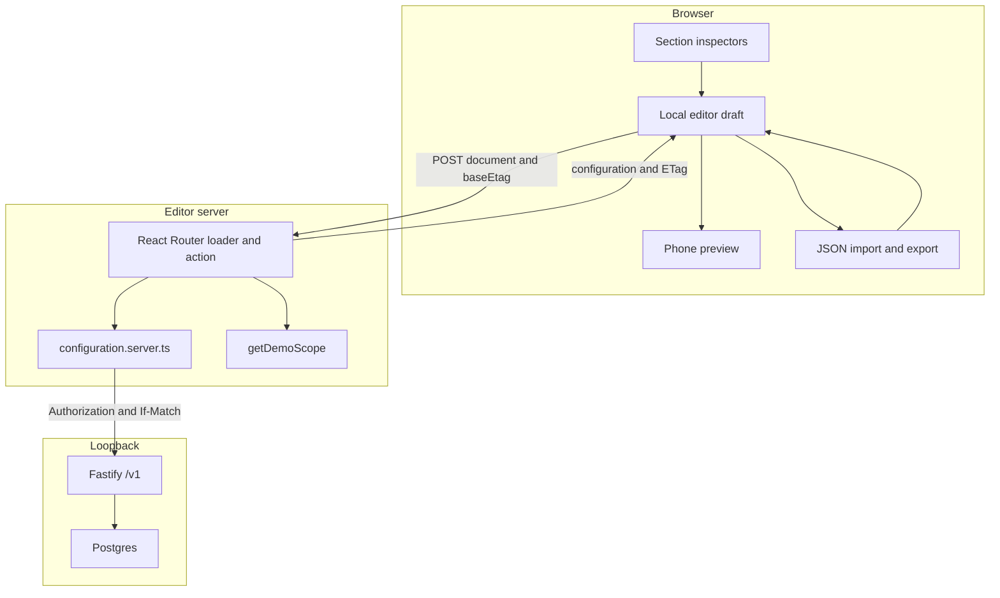

# Architecture

This page describes the system in this repository. The longer proposal is `docs/Reactiv_Assessment_Architecture_Client_Inspired.md`. Sections 10–12 of that proposal are not built. They are marked at the end of this page.

## Trust boundary



The browser sends `GET /` and `POST /?index` to the editor origin. It does not send `Authorization` to the configuration service, and it does not choose the tenant or the configuration id. `getDemoScope()` in `apps/editor/app/services/session.server.ts` reads `DEMO_TENANT_ID` and `DEMO_CONFIGURATION_ID` from the server environment and ignores the query string and the body.

`apps/editor/app/services/configuration.server.ts` is the only editor module that reads `CONFIG_SERVICE_TOKEN` or opens a socket to `CONFIG_SERVICE_URL`. The UI, the reducer, and `packages/contracts` do not. The editor package does not depend on `pg`. Postgres access stays in `apps/config-service/src/configurations/repository.ts`.

The private API checks the bearer token even on loopback. A missing token, a wrong token, and the placeholder `replace-me` do not reach the repository. Error text is redacted. Request logs keep a request id and do not keep the token or the document body. The same request id can be shown on a failed load or save. Details of the load and save path are in `docs/boundary.md`.

## Processes

| Piece | Where | What it does |
| --- | --- | --- |
| Editor | `apps/editor` | React Router 7.18.4 framework mode, `ssr: true`, TypeScript |
| Private API | `apps/config-service` | Fastify. Create, load, and conditional update |
| Contracts | `packages/contracts` | Zod schemas, limits, section factories, error shape |
| Database | `compose.yaml`, `db/migrations/001_configurations.sql` | Postgres 16, named volume `reactiv_pg` |

`pnpm dev:service` and `pnpm dev:editor` load unset keys from the repo `.env` and then start those processes. Migrate and seed do the same. The processes themselves do not open the file.

## Document

Array order is the screen order. There is no second position field and no `settings` wrapper.

```ts
type Image = { id: string; url: string; alt: string };

type Section =
  | { id: string; type: "carousel"; images: Image[]; aspectRatio: "portrait" | "landscape" | "square" }
  | { id: string; type: "text"; title: string; description: string; titleColor: string; descriptionColor: string }
  | { id: string; type: "cta"; label: string; url: string; backgroundColor: string; labelColor: string };

type EditableDocument = { schemaVersion: 1; data: { sections: Section[] } };

type Configuration = EditableDocument & {
  id: string;
  revision: number;
  updatedAt: string;
};
```

Three version ideas stay separate:

| Name | Meaning |
| --- | --- |
| `/v1` | HTTP contract |
| `schemaVersion` | Document format. Only `1` is accepted |
| `revision` | Concurrency counter for one configuration. The strong ETag is the quoted revision |

The service generates configuration ids, revisions, and `updatedAt`. The browser cannot set those. Section and image ids are stable strings. They are not authorization. Colors that pass validation are stored as lowercase `#rrggbb`. Portrait, landscape, and square are stored as names. The preview maps them to `3 / 4`, `16 / 9`, and `1 / 1`.

`sectionRegistry` in `packages/contracts/src/registry.ts` builds a default carousel, text section, or button. `sectionUiRegistry` in `apps/editor/app/features/sections/section-ui-registry.tsx` maps each type to one inspector and one preview. The shell does not switch on the type itself. Adding a quiz or video section means extending the union, the Zod schema, the factory, one inspector, one renderer, and fixtures. The `data` column stays JSON. That function set does not include a quiz today.

Schema version 2 is rejected by `editableDocumentSchema` and by import. Nothing is written. A pure migration from version N to N+1 does not exist yet.

## Table

`configurations` has `tenant_id`, `id`, `schema_version`, `revision`, `data` jsonb, and `updated_at`. The primary key is `(tenant_id, id)`. Every repository statement includes `tenant_id`. The demo tenant comes from `DEMO_TENANT_ID`. There is no row-level security policy in the migration.

The update is one statement:

```sql
UPDATE configurations
SET data = $1::jsonb,
    schema_version = $2,
    revision = revision + 1,
    updated_at = now()
WHERE tenant_id = $3
  AND id = $4
  AND revision = $5
RETURNING id, schema_version, revision, updated_at, data;
```

If no row changes, a second tenant-scoped lookup tells a missing id from a stale revision. The service returns success only after commit. Validation runs before that update. An invalid document leaves the stored JSON unchanged.

## HTTP

| Method and path | Success | Failure examples |
| --- | --- | --- |
| `POST /v1/configurations` | `201`, configuration, `Location`, strong `ETag` | `422` invalid document |
| `GET /v1/configurations/:id` | `200`, configuration, strong `ETag` | `401` bad credential, `404` unknown id for this tenant |
| `PUT /v1/configurations/:id` | `200` when `If-Match` is the current strong ETag | `412` stale revision, `428` missing precondition, `422` invalid document |

There is no list route and no PATCH. Successful configuration responses use `Cache-Control: private, no-store`. The body limit is 256 KiB. Authenticated writes are limited per process. The default is 600 per minute. That limit is a local guard, not a claimed capacity.

## Editor state and the save race

`useReducer` holds the draft, the selection, the dirty flag, and the save sequence. Inspectors and the preview read that draft. UI-only fields stay out of the saved payload.

Save copies the validated document, the local sequence, and the base ETag into an immutable snapshot. Typing can continue. Only one save runs at a time.

When the response for snapshot A arrives:

- If the editor sequence is still A's sequence, the normalized server document becomes the draft and the editor shows saved.
- If the author has typed since the click, the draft stays on the newer text, the editor stays unsaved, and the new ETag is kept for the next Save. Reload shows A, the document the server stored.
- A 412 does not write. The draft stays. The author can compare with the server document or reload it on purpose. A loader refresh does not replace a dirty draft.

The component test for the A-then-B case is `keeps B when A's save completes, and a reload shows A`.

Import replaces the draft only after the whole file validates. It does not change the base revision. Export writes the current valid draft, including unsaved edits, and omits service-owned fields.

## What sections 10–12 describe, and what is absent

Architecture sections 10–12 are a production sketch. None of the following is implemented:

- A publish operation separate from Save, an outbox, a publisher worker, immutable release artifacts, or a content delivery network.
- The cache table for public artifacts, active-release pointers, or edge TTLs.
- Shopify or other partner connectors, native apps, or a product catalog inside the document.
- An AWS deployment, multi-AZ Postgres, secret rotation, cells, or cross-region failover.
- The proposed envelopes in section 12, including shopper request rate, write rate, delivery latency, a 99.95% availability target, publish propagation, and recovery objectives.

The local preview number in `docs/preview-benchmark.md` is one laptop observation. It does not establish those targets. Postgres row-level security, production sessions, and tenant quotas are not built. The demo API's 412 check is the concurrency control that does exist.
